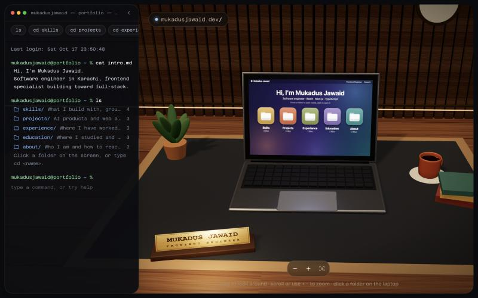
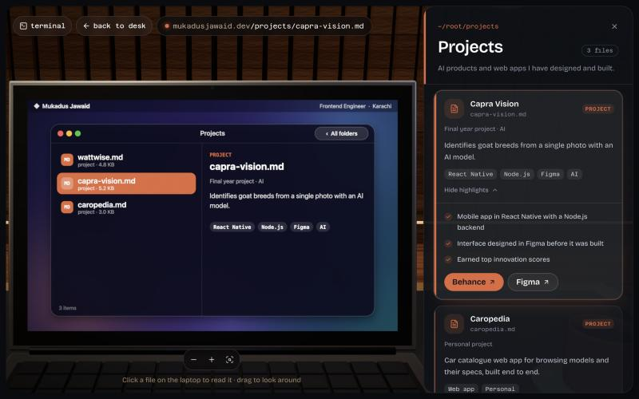
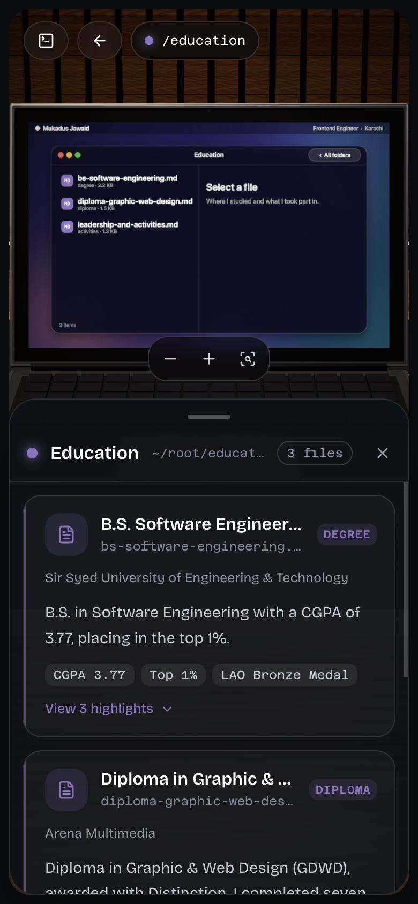

<div align="center">



<br />

**A 3D desk you can walk up to.** Open a folder on the laptop, read the work, or just type `cd projects`.

[](https://nextjs.org) [](https://react.dev) [](https://www.typescriptlang.org) [](https://threejs.org) [](https://tailwindcss.com)

**[Live site](https://mukadusjawaid.vercel.app)** · [Features](#-features) · [Quick start](#-quick-start) · [Make it yours](#-make-it-yours) · [How it works](#-how-it-works)

</div>

<br />

<table>
  <tr>
    <td width="38%"></td>
    <td width="38%"></td>
    <td width="24%"></td>
  </tr>
  <tr>
    <td align="center"><sub>The desk</sub></td>
    <td align="center"><sub>Open a folder</sub></td>
    <td align="center"><sub>On a phone</sub></td>
  </tr>
</table>

---

## ✨ Features

|   |   |
| --- | --- |
| 🖥️ **A real 3D scene** | A warm study with a laptop, built with Three.js. Drag to orbit, scroll or pinch to zoom, recentre with one button. |
| 💻 **A live laptop screen** | The screen is a canvas texture, so hover, clicks and windows all work on the 3D glass. Hover a folder to peek inside. |
| ⌨️ **A working terminal** | `ls`, `cd`, `cat`, `help`, `clear`, with a real shell history. Resize it, hide it, or ignore it. |
| 📱 **Fully responsive** | Floating panels on desktop, bottom sheets on tablets and phones. Nothing overflows, from 360px up. |
| 🎨 **Token-driven design** | Every colour and font size comes from `src/styles/`. Change a token, change the site. |
| 🔎 **Built to be found** | Crawlable text version, structured data, share card, sitemap and a full favicon set. |
| 📦 **No downloaded assets** | Wood, felt, leather, brass and paper are all generated in code. |

## 🎮 Controls

| Do this | To get this |
| --- | --- |
| Hover a folder on the laptop | A quick list of the files inside |
| Click a folder or a file | Open it. The camera moves in and the details appear |
| Drag · scroll · pinch | Orbit and zoom around the desk |
| **−** / **+** / **⌖** | Zoom out, zoom in, recentre on the laptop or the screen |
| `ls` · `cd <folder>` · `cd ..` | Look around and move between folders |
| `cat <file>` | Open a document |
| `help` · `clear` | List commands, or empty the terminal (also **Ctrl+L** / **⌘K**) |
| Drag the terminal's right edge | Resize it. Your width is remembered. Double-click to reset |

## 🚀 Quick start

```bash
npm install
npm run dev        # http://localhost:3000
```

| Script | |
| --- | --- |
| `npm run dev` | Dev server. The first load compiles the 3D code, so it is slower than production |
| `npm run dev:clean` | Clears the build cache first, then starts the dev server (use it if styles look wrong) |
| `npm run build` · `npm start` | Production build, and serve it |
| `npm run lint` | ESLint |

> For the real speed, run `npm run build && npm start`. Requires Node.js 20 or newer. No environment variables are needed (the optional ones are under [SEO](#-seo)).

## ✏️ Make it yours

### Content

Everything you read on the site is plain TypeScript, one file per folder:

```
src/features/desk/data/
├── folders/
│   ├── skills.ts      projects.ts     experience.ts
│   ├── education.ts   about.ts        index.ts   ← the order on the desk
└── scene3d.ts         ← name, role, shell prompt, camera settings
```

```ts
{
  name: "caropedia.md",          // file name, used by `cat`
  title: "Caropedia",            // card title
  size: "3.0 KB",                // shown in `ls`
  kind: "PROJECT",               // small label on the card
  meta: "Personal project",      // one line of context: dates, place, role
  desc: "A short summary.",
  tags: ["Web app"],
  notes: ["Highlight one", "Highlight two"],   // shown when the card opens
  links: [{ t: "Live ↗", slug: "caropedia", url: "https://…", primary: true }],
}
```

- **Add a folder:** create `data/folders/<name>.ts`, register it in `folders/index.ts`, and add one line, `--folder-<name>`, to `src/styles/tokens.css`. A tile appears on the laptop automatically.
- **A pill beside a folder title**, like *2.5+ years experience*: set `badge` on the folder.
- **A typo fails loudly at startup**, because Zod checks every field.

### Design tokens

No component writes a colour or a font size. Everything comes from `src/styles/`:

| File | What it holds |
| --- | --- |
| `tokens.css` | Surfaces, text shades, link and status colours, window buttons, one `--folder-<id>` accent per folder, lines, radii, shadows, motion. Also available as classes: `bg-panel`, `text-fg-muted`, `border-line` |
| `typography.css` | The two font roles, the type scale (`text-micro` to `text-display`), weights and tracking |
| `tokens.ts` | A small TypeScript mirror for the places CSS variables don't exist: page metadata and the share image |

The 3D world is the one exception, because Three.js needs real values in JavaScript. Its colours live in `features/desk/scene3d/palette.ts`, while the laptop screen reads the folder and window colours from the CSS tokens at runtime.

> **Privacy:** don't put a CV in `public/` if it has contact details you don't want to share. Anything in `public/` is downloadable by anyone.

## 🧩 How it works

```
src/
├── app/                 routes, metadata, sitemap, robots, manifest, icons, share image
├── components/ui/       shadcn/ui primitives
├── styles/              design tokens and typography
├── features/seo/        site config, structured data, crawlable text, share image
└── features/desk/       the experience (feature-based)
    ├── components/      terminal, stage, details panel, cards, resize handle
    ├── scene3d/         room, laptop, camera controller, screen drawing, textures, palette
    ├── store/           Zustand: desk state, layout, camera actions
    ├── lib/             terminal commands, layout maths, media hooks, tone helpers
    └── schemas/ · data/ · types.ts
```

A few decisions worth knowing about:

- **Panels never resize the canvas.** The terminal and details float over a full-screen 3D stage and only animate `transform` and `opacity`. A resizing WebGL canvas is what makes slides stutter.
- **The camera frames the free space.** The projection is shifted for each floating panel, so the laptop stays centred between them while remaining the pivot for orbit and zoom. On the screen, the real corners of the laptop are fitted, so nothing is cropped at any window size.
- **The screen is a texture.** The laptop UI is drawn with the 2D canvas API at 1.6× resolution and hit-tested through the mesh's UV coordinates.
- **Time-based motion.** Camera moves use a clock-driven tween, so they take the same time on slow and fast devices.
- **The terminal is a log.** Navigation and commands append to a history, and the terminal and the details panel stay in sync because both read the same store.

| | |
| --- | --- |
| **Framework** | Next.js 16 (App Router), React 19, TypeScript |
| **3D** | Three.js, `@react-three/fiber`, `@react-three/drei` |
| **UI** | Tailwind CSS 4, shadcn/ui on Base UI, Lucide, Framer Motion |
| **State and data** | Zustand (only the terminal width is saved, in `localStorage`), Zod |

## 🔎 SEO

The desk is a canvas, which search engines can't read, so the site also ships what they need:

- **A text version of the portfolio.** `features/seo/SeoContent.tsx` renders every folder as real headings, summaries and links. It is generated from the same data as the desk, so the two can't disagree. It is visually hidden but available to search engines and screen readers.
- **Metadata** (title, description, canonical, Open Graph, Twitter) and a generated 1200×630 share image that uses the favicon.
- **Structured data:** a schema.org `Person` and `WebSite` that link your GitHub, LinkedIn and Behance.
- **`sitemap.xml`, `robots.txt`, a web manifest** and a full favicon set (SVG, ICO, Apple and PWA icons).

| Optional variable | Use |
| --- | --- |
| `NEXT_PUBLIC_SITE_URL` | The live address, if it is not `https://mukadusjawaid.vercel.app` |
| `NEXT_PUBLIC_GOOGLE_SITE_VERIFICATION` | The code from Google Search Console, to verify ownership |

> No site can guarantee first place on Google. What helps: deploy, verify the site in [Google Search Console](https://search.google.com/search-console), submit `sitemap.xml`, request indexing, and link to the site from your GitHub, LinkedIn and Behance profiles.

## ⚡ Performance and accessibility

- Shaders are compiled off the main thread before the scene appears, and the wall boards are a single instanced mesh.
- Render resolution drops only while you drag the camera, and returns to full as soon as you stop.
- `prefers-reduced-motion` is respected (no intro glide).
- Hidden panels are `inert`, so keyboard focus never lands on something off-screen.
- Folders can be opened without a mouse, and the terminal resize handle works with the arrow keys.
- If WebGL isn't available, the stage falls back to a plain list of folders.

## 🛠️ Troubleshooting

| Symptom | Fix |
| --- | --- |
| Grey folder tiles, a see-through terminal, or wrong font sizes in dev | The dev cache is stale. Stop the server and run `npm run dev:clean` |
| "Another next dev server is already running" | Open the address it prints, or stop that process first. Next allows one dev server per project |
| Odd behaviour after running a build | Don't run `npm run build` while `npm run dev` is running: both use the `.next` folder |

## ☁️ Deploy

A standard Next.js app with no server code and no required environment variables. Import the repository on [Vercel](https://vercel.com/new), or run `npm run build && npm start` anywhere that runs Node.

---

<div align="center">

Designed and built by **Mukadus Jawaid** · Karachi

[GitHub](https://github.com/MukadusJawaid) · [LinkedIn](https://www.linkedin.com/in/mukadusjawaid/) · [Behance](https://www.behance.net/mukadusjawaid)

</div>
